<h4 align="center">Patches in <a href="https://github.com/anomalyco/opencode">opencode</a>, <a href="https://github.com/nyx-space/hifitime">hifitime</a> and the <a href="https://github.com/ps5-payload-dev/sdk">PS5 payload SDK</a></h4>
<h4 align="center">Merged so far: <a href="https://github.com/nyx-space/hifitime/pull/530">saturation in Duration arithmetic</a> and <a href="https://github.com/ps5-payload-dev/sdk/pull/79">a missing include that broke PS5 SDK builds on clang</a></h4>
<h4 align="center">Building <a href="https://github.com/Xtacy856X/Daedalus">Daedalus</a>, a Rust workspace manager for humans and AI agents</h4>

  
  
  

---

## Github stats and activity

  

  
  

  

 

- Console work: PS5 payloads in C on the ps5-payload-dev SDK, dynamic linking, firmware and process info
- Time is hard: leap seconds, GNSS time scales, UT1 and Julian date offsets in Rust
- Coding agents: TypeScript streams, cancellation and shutdown paths that actually exit
- Go services, PASETO tokens and migrations away from abandoned modules
- Godot games and small HTML5 toys, because sometimes you want to watch the thing move

  
  

  
  
  

 

## Selected work

| Project | What it is | Stack |
| --- | --- | --- |
| [ps5info](https://github.com/Xtacy856X/ps5info) | PS5 payload that reports firmware, hardware, memory and process info | C |
| [Daedalus](https://github.com/Xtacy856X/Daedalus) | Rust workspace manager for humans and AI agents, persistent terminals, layouts, checkpoints and a Telegram bridge | Rust |
| [hifitime](https://github.com/nyx-space/hifitime/pulls?q=is%3Apr+author%3AXtacy856X) | Leap second alignment, IRNSS and QZSS scales, GNSS Julian dates, UT1 cache | Rust |
| [opencode](https://github.com/anomalyco/opencode/pulls?q=is%3Apr+author%3AXtacy856X) | Event stream stalls, model catalog races, Homebrew update verification | TypeScript |
| [developers-italia-api](https://github.com/italia/developers-italia-api/pull/474) | Token handling moved from an abandoned module to aidanwoods.dev/go-paseto | Go |
| [ps5-payload-dev/sdk](https://github.com/ps5-payload-dev/sdk/pull/79) | Include tree fixes for payload builds | C |
| [PS5 14.10 jailbreak research](https://github.com/Xtacy856X/PS5-14.10-Jailbreak-Research) | WebKit notes and test harnesses for firmware 14.10 | JavaScript |

## Tools and technologies

  

 

 
